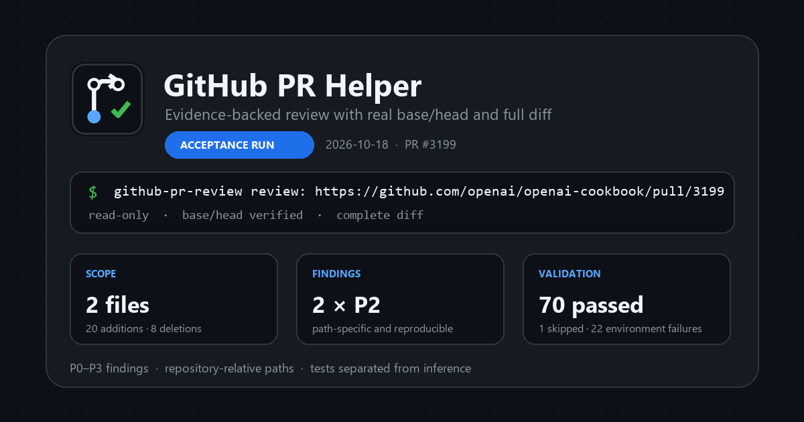

<p align="center">
  
</p>

# GitHub PR Helper

一个只包含 Skill 的 Codex/ChatGPT 插件，用于审查 GitHub Pull Request 和本地分支差异。它优先报告可验证的正确性、回归、安全和测试风险，并给出文件级证据与最小修复方向。

当前公开版本：`0.1.0`



## 功能

- 读取 PR 的 base/head 范围，而不是只检查当前工作区。
- 审查调用方、兼容性、错误处理、安全边界和测试覆盖。
- 在安全且可执行时运行相关测试、类型检查或构建。
- 默认只输出审查结论，不修改代码、不提交 GitHub Review。
- 没有独立服务端、遥测或数据存储；审批结果直接回到当前 Codex 任务。

## 安装

从 GitHub 安装：

```powershell
codex plugin marketplace add man178197/github-pr-helper-plugin
codex plugin add github-pr-helper@github-pr-helper-plugins
```

安装后新建 Codex 任务，然后输入：

```text
$github-pr-review 审查这个 Pull Request：https://github.com/openai/openai-cookbook/pull/3199
```

也可以直接描述任务，让 Codex 根据 Skill 描述自动选择。

本地开发安装：

```powershell
codex plugin marketplace add .
codex plugin add github-pr-helper@github-pr-helper-plugins
```

不要添加 `--sparse .agents/plugins`，因为插件包位于 `plugins/` 目录。

## 使用方式

插件会从 PR URL 读取 base/head、提交、变更文件和 diff。审查结论按严重程度排序，并包含：

- `P0` 到 `P3` 严重程度；
- 仓库相对路径及窄范围行号或符号；
- 可复现的失败路径；
- 最小修复方向；
- 已运行的测试与源码推断之间的区别。

若没有可操作问题，插件会直接说明，不为了扩充报告而制造低价值意见。

## 仓库结构

```text
github-pr-helper-plugin/
├── .agents/plugins/marketplace.json
├── .github/workflows/validate.yml
├── .github/dependabot.yml
├── plugins/github-pr-helper/
│   ├── plugin.json
│   ├── .codex-plugin/plugin.json
│   ├── assets/
│   └── skills/github-pr-review/SKILL.md
├── scripts/validate_repo.py
├── PRIVACY.md
├── TERMS.md
└── SUPPORT.md
```

`plugin.json` 是便携式 Agent Plugins 清单；`.codex-plugin/plugin.json` 是 Codex 兼容清单。

## 验证

```powershell
python scripts/validate_repo.py
```

GitHub Actions 会在每次 push 和 pull request 时运行同一套检查。

## 维护与政策

- [支持与问题反馈](SUPPORT.md)
- [隐私政策](PRIVACY.md)
- [服务条款](TERMS.md)
- [安全政策](SECURITY.md)
- [版本记录](CHANGELOG.md)
- [真实 PR 验收记录](docs/acceptance-2026-10-18.md)

本项目使用 [MIT License](LICENSE)。
